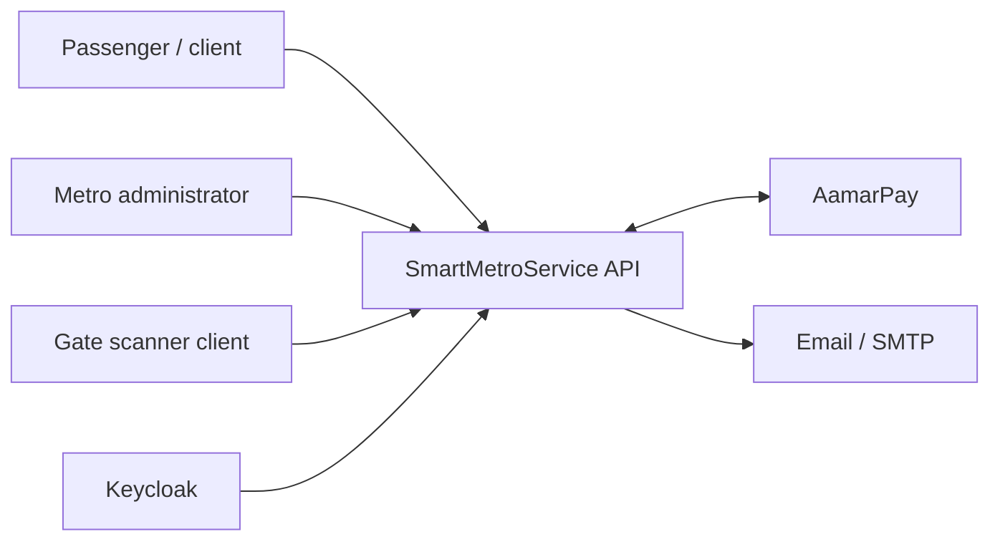
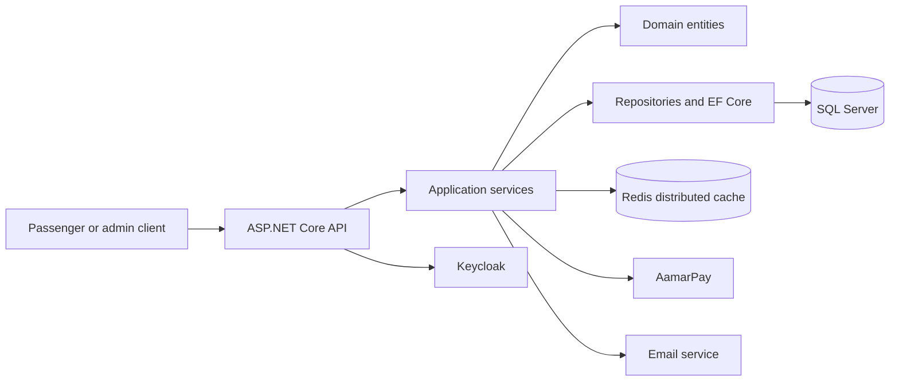

# System Context

## Level 1: System context

Actors/relationships are inferred from endpoints and integrations; deployment trust boundaries are **Confirm**.

## Level 2: Containers

The domain project defines types and has no database engine. The current repository has no separately deployed frontend or gate device implementation.
